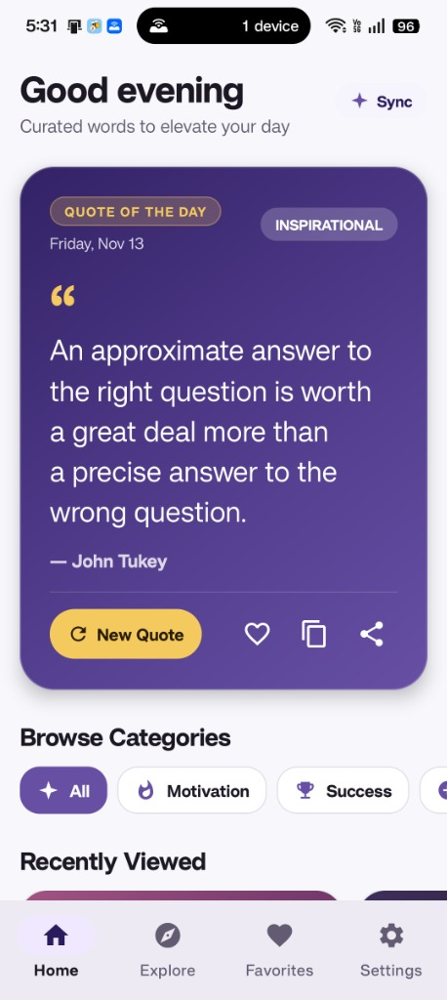
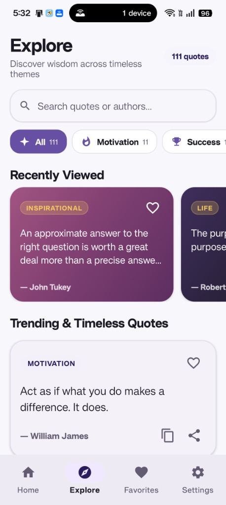
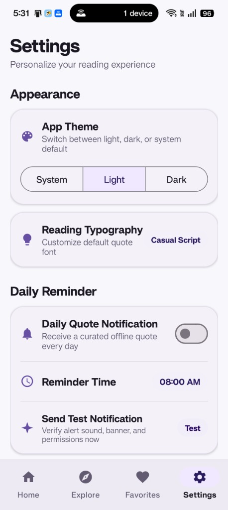

# QuoteVerse – Daily Inspiration

**QuoteVerse – Daily Inspiration** is an offline-first, editorial-grade native Android quotes application crafted in Kotlin with XML layouts, Material Design 3, MVVM architecture, Room persistence, and live **ZenQuotes API** integration.

## Project Overview

QuoteVerse provides a serene, distraction-free space for daily reflection and literary inspiration. Pre-populated with **110 curated classic, literary, and traditional quotes** across 10 timeless themes, every feature works completely offline. Connected users enjoy live quotes from the free **ZenQuotes API** without needing an API key, featuring intelligent batch caching, duplicate prevention, and strict rate-limit protection.

## Screenshots

| Home Screen | Explore & Categories | Settings & Typography |
|:---:|:---:|:---:|
|  |  |  |

## Features

- **Home Screen**
  - Time-aware greeting header (`Good morning`, `Good afternoon`, `Good evening`)
  - Featured **Quote of the Day** hero card with editorial serif typography and warm gold accents
  - Header sync pill to fetch fresh batches from ZenQuotes
  - One-tap **New Quote** randomizer (serves from local Room cache to protect rate limits), **Favorite** toggle, **Copy**, and **Share**
  - Horizontal **Browse Categories** filter strip
  - **Recently Viewed** horizontal carousel synced with user exploration
  - **Trending Quotes** feed powered by `ListAdapter` + `DiffUtil`
  - ZenQuotes API attribution footer with info dialog
- **ZenQuotes API Integration (100% Free • No API Key)**
  - Endpoints used:
    - `https://zenquotes.io/api/today` (Quote of the day synchronization)
    - `https://zenquotes.io/api/quotes` (Batch of 50 quotes fetched and cached in Room)
    - `https://zenquotes.io/api/random` (On-demand random quote with fallback)
  - **Rate Limiting (5 requests per 30 seconds)**: Strict client-side sliding window throttle with penalty detection if rate-limited
  - **Duplicate Prevention**: Normalized text checking against Room before insert to prevent duplicate quotes
  - **Smart Categorization**: Keyword-based categorizer mapping incoming API quotes into QuoteVerse's 10 categories
  - **Attribution**: Transparent attribution across Settings, About dialog, and Home screen ("Inspirational quotes provided by ZenQuotes API")
- **Explore Screen**
  - Live offline search across both quote text and author names
  - Filter across **10 curated categories**: Motivation, Success, Life, Love, Happiness, Wisdom, Friendship, Attitude, Study, and Inspirational
  - Live category item counts and illustrated empty states with filter reset
- **Favorites Screen**
  - Locally persisted favorites in Room Database across app restarts
  - Undoable removal via Material `Snackbar`
  - Empty-state illustration with direct navigation to Explore
- **Quote Details Screen**
  - Full-screen immersive editorial presentation
  - **6 curated gradient atmospheres** (Royal Velvet, Twilight Lavender, Obsidian Gold, Rose Dusk, Cosmic Indigo, Warm Amber)
  - **Typography & Font Selection**: Choose between Editorial Serif, Modern Sans, Classic Monospace, and Casual Script
  - **Font Size Stepper**: Live text scaling from 18sp to 36sp with immediate preview
  - **Save Quote as Image**: High-resolution `1080×1350` PNG export saved to `Pictures/QuoteVerse` via `MediaStore`
  - **Share Generated Quote Poster**: One-tap export to Android Sharesheet via `FileProvider` for sharing directly to Instagram, WhatsApp, X, etc.
  - Favorite toggle, copy to clipboard, and text share
- **Horizontal Slide & Swipe Navigation**
  - **Swipe Left (`<-`)**: Smoothly navigates forward to the next tab (`Home` -> `Explore` -> `Favorites` -> `Settings`)
  - **Swipe Right (`->`)**: Smoothly navigates backward to the previous tab (`Settings` -> `Favorites` -> `Explore` -> `Home`, or dismisses `Quote Details`)
  - **Directional Slide Animations**: Moving forward slides screens in from the right; moving backward slides screens in from the left
  - **Bottom Navigation Sync**: `BottomNavigationView` indicator updates synchronously with swipe motions
  - **Smart Scroll Disallow**: Horizontal RecyclerViews (category chips, recently viewed quotes, gradient swatches) and search inputs scroll naturally without accidental tab switching
- **Settings Screen**
  - **Light / Dark / System** theme switching persisted via `SharedPreferences`
  - **Reading Typography**: Customize default app quote font (Serif, Sans, Monospace, Casual)
  - **ZenQuotes API** sync cards (Batch Sync 50 quotes, Today Quote Sync, and Attribution)
  - **Daily Quote Notification** toggle, `MaterialTimePicker` exact reminder scheduler (`AlarmManager.setExactAndAllowWhileIdle`), and instant **Send Test Notification**
  - About dialog, Privacy Policy summary, and live app version display

## Technology Stack

- **Language:** Kotlin (AGP 9.0.1 built-in Kotlin)
- **UI Toolkit:** Native Android XML Layouts, ViewBinding, Material Design 3 (`1.13.0`)
- **Architecture:** MVVM + Repository Pattern (Offline-First)
- **Networking:** Retrofit (`2.11.0`), OkHttp (`4.12.0`), Gson (`2.11.0`)
- **Navigation:** AndroidX Navigation Component (`FragmentContainerView` + `BottomNavigationView`)
- **Database:** Room (`2.8.5`) with KSP (`2.3.6`)
- **Concurrency & State:** Kotlin Coroutines & Flow (`StateFlow`), `LiveData`, Lifecycle-aware `repeatOnLifecycle`
- **Minimum SDK:** API 24 (Android 7.0) • **Target / Compile SDK:** API 36

## Architecture & Project Structure

```text
com.snj.quoteverse
├── adapters/          # ListAdapter + DiffUtil adapters (Quotes, Recent, Categories, Swatches)
├── data/
│   ├── api/           # ZenQuotes Retrofit service, DTOs, RateLimiter, Categorizer
│   ├── dao/           # Room QuoteDao queries & transactions
│   ├── database/      # QuoteDatabase & 110-quote QuoteSeedData
│   ├── entity/        # QuoteEntity schema
│   └── repository/    # QuoteRepository coordinating Room, ZenQuotes API & preferences
├── ui/
│   ├── details/       # QuoteDetailsFragment (full-screen showcase & PNG export)
│   ├── explore/       # ExploreFragment (search & category filtering)
│   ├── favorites/     # FavoritesFragment (saved quotes & undoable removal)
│   ├── home/          # HomeFragment (daily quote, categories, recent, trending, sync)
│   └── settings/      # SettingsFragment (theme, daily reminders, ZenQuotes sync & info)
├── utils/             # ThemeManager, ImageExportUtils, NotificationScheduler, PreferencesManager
└── viewmodel/         # QuoteViewModel & QuoteViewModelFactory (StateFlow / SyncState)
```

## Installation Instructions

1. Clone or open the repository in **Android Studio** (JDK 17+ and Android SDK 36 installed).
2. Let Gradle sync using the bundled Gradle wrapper (`9.4.1`).
3. Build the debug APK from the terminal:
   ```bash
   ./gradlew assembleDebug
   ```
4. Run unit tests (30/30 passing):
   ```bash
   ./gradlew testDebugUnitTest
   ```
5. Install the generated APK on an Android device or emulator (API 24+):
   - Output path: `app/build/outputs/apk/debug/app-debug.apk`

## ZenQuotes API Compliance & Attribution

Inspirational quotes provided by [ZenQuotes API](https://zenquotes.io/).
- **No API Key Required**: Fully functional out of the box using public free endpoints (`/api/random`, `/api/today`, `/api/quotes`).
- **Rate Limit Compliance**: Strictly respects the free tier limit of **5 requests per 30 seconds** using `ZenQuotesRateLimiter` sliding window, catching `"Too many requests"` warnings and enforcing cooldown penalties.
- **Offline-First & Smart Caching**: Room Database is the single source of truth. All incoming quotes are deduplicated and categorized before insertion.
- **Attribution**: Displayed prominently on the Home screen footer, Settings screen, and About dialog with direct links to https://zenquotes.io.

## How to Test Online and Offline Functionality

### 1. Online Testing (Wi-Fi / Mobile Data Enabled)
- **Today's Quote Sync**:
  1. Open QuoteVerse. On startup, the app soft-syncs the official Quote of the Day from `https://zenquotes.io/api/today` into Room.
  2. Navigate to **Settings** > **Quote Source & Sync** > tap **Sync Today's Quote**.
  3. Notice the success Snackbar: `"Quote of the Day updated from ZenQuotes"`. The hero card on the Home screen immediately reflects this quote.
- **Random Online Quote**:
  1. On the **Home** screen, tap the **New Quote** button.
  2. The button's refresh icon spins smoothly as it calls `https://zenquotes.io/api/random`.
  3. The hero quote card updates with the freshly fetched quote, automatically categorized and cached in Room.
- **Batch Quotes Sync (50 Quotes)**:
  1. On the **Home** screen, tap the top **Sync** pill, or go to **Settings** > tap **Sync Quotes Batch**.
  2. The sync pill shows an active spinner (`Sync…`). Upon completion, a Snackbar indicates: `"Synced X new quotes from ZenQuotes"`.
  3. Switch to the **Explore** tab to browse the newly cached quotes across the 10 categories.
- **Rate-Limit Safeguard**:
  1. Rapidly tap the sync button more than 5 times within 30 seconds.
  2. The app prevents flooding the API and displays a helpful notice: `"ZenQuotes rate limit (5 requests / 30s) reached. Retry in X seconds."` without crashing.

### 2. Offline Testing (Airplane Mode Enabled)
- **Turn On Airplane Mode** on your device or emulator.
- **Notice the Offline Banner**:
  - The Home screen dynamically surfaces an elegant indicator: `"Offline Mode • Browsing cached quotes"`.
- **Browse & Search**:
  - Browse all 10 categories and search quotes by text or author on the **Explore** screen—all queries run at lightning speed locally via Room Database.
- **Favorites & Quotes Details**:
  - Add/remove favorites, copy quotes to clipboard, and generate 1080×1350 PNG images in **Quote Details**—all functionality works 100% offline.
- **New Quote Offline Fallback**:
  - Tap **New Quote** while offline. The app catches the network unavailability and instantly serves a curated quote from the Room cache without delay or error.
- **Batch Sync Retry State**:
  - Tap **Sync** while offline. The app displays `"Network unavailable. Showing local quotes."` accompanied by a clickable **Retry** action button.
- **Turn Airplane Mode Off**:
  - Tap **Retry** on the Snackbar or tap the offline banner's retry button—sync immediately resumes and fetches fresh quotes.
